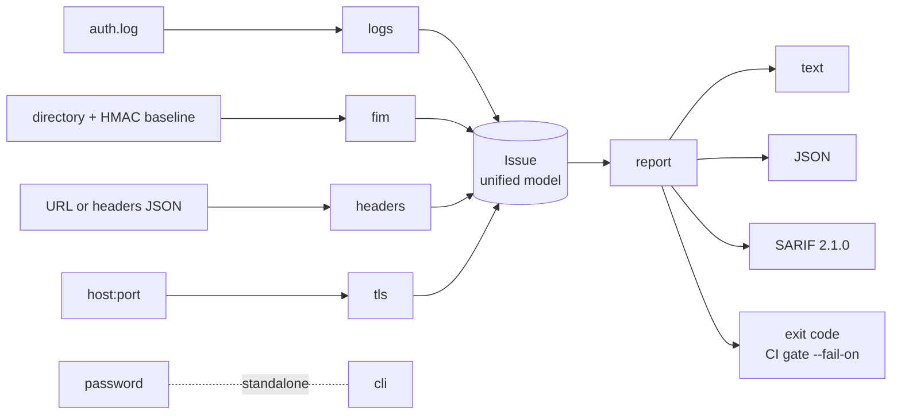

# SecFund — Defensive Cybersecurity Fundamentals Toolkit


Five fundamental defensive-security controls (**log detection, file integrity, passwords, HTTP headers and TLS**) in pure Python, with **zero runtime dependencies**. Every finding is mapped to **MITRE ATT&CK / OWASP / NIST / CIS** and can be exported as **JSON** or **SARIF 2.1.0** (the GitHub Code Scanning format), with exit codes designed for **CI gates**.

The goal is not "yet another tool" but to show how security code is written: **treat input as hostile**, **fail safely** and **document the decisions** ([threat model](docs/THREAT_MODEL.md) and [ADRs](docs/DECISIONS.md)).

## Modules

| Command | What it does | References |
|---|---|---|
| `logs` | Detects **brute force**, **password spraying** and **distributed attacks** (many IPs against one account) in SSH logs; flags possible compromise (login accepted after the failures); supports CIDR allowlists, IPv6 and ISO 8601 timestamps | MITRE T1110.001/.003, T1078 · CIS 8 |
| `fim` | **File integrity monitor** (SHA-256) with an **HMAC-signed baseline** that detects tampering with the baseline itself and signature-stripping (downgrade) attacks | MITRE T1565, T1505.003, T1070 · CIS 3 |
| `password` | Audits passwords (including *leetspeak* variants), **generates** secure passwords, hashes with **scrypt** (or PBKDF2), **verifies** hashes and checks breaches via **k-anonymity** (HIBP) or an offline file | NIST SP 800-63B · OWASP Password Storage |
| `headers` | Analyzes **HTTP security headers** and **cookie flags** (Secure/HttpOnly/SameSite) and assigns an A–F grade | OWASP A05:2021 |
| `tls` | Audits the **certificate** (validity, chain, hostname, expiration) plus the negotiated **protocol** and **cipher suite** | OWASP A02:2021 · CIS 3.10 |



## Install and usage

```bash
python -m pip install .            # or just run from the folder: python -m secfund
secfund --version
```

```bash
# SSH logs: detect attacks and ignore your internal scanner
secfund logs samples/auth.log --year 2026 --allow-ip 10.0.0.0/8

# File integrity with a signed baseline (keep the key OFF the monitored server)
secfund fim keygen --key-file fim.key
secfund fim init  /var/www/site --baseline baseline.json --key-file fim.key --exclude "*.log"
secfund fim check /var/www/site --baseline baseline.json --key-file fim.key

# Passwords
secfund password --generate --length 24 --hash      # generate + audit + scrypt hash
secfund password --verify 'scrypt$131072$8$1$...'   # verify (and warn if a rehash is due)
secfund password --pwned                            # only 5 chars of the SHA-1 leave the machine

# Web / TLS (your own or authorized targets only)
secfund headers --url https://your-site.com
secfund tls your-site.com:443

# Reports for tools and CI
secfund logs auth.log --format sarif -o result.sarif
secfund headers --url https://your-site.com --fail-on high     # fail only on HIGH/CRITICAL
```

**Exit codes:** `0` clean · `1` findings · `2` CRITICAL finding · `3` usage/I-O error · `4` tampered baseline.
**Severities:** `CRITICAL`, `HIGH`, `MEDIUM`, `LOW`, `INFO`.

### Real output examples

`logs` (file `samples/auth.log`):

```
28 events analyzed | threshold=5 failures/5min

[CRITICAL] Brute force from 203.0.113.45: 7 failures, 3 user(s) (T1110.001) [POSSIBLE COMPROMISE: login accepted after the failures]
    target users: admin, root, ubuntu
[HIGH] Distributed attack from 6 distinct IPs: 6 failures, 1 user(s) (T1110.001)
    target users: deploy
    sources: 192.0.2.101, 192.0.2.102, 192.0.2.103, 192.0.2.104, 192.0.2.105, 192.0.2.106
[MEDIUM] Password spraying from 198.51.100.7: 6 failures, 6 user(s) (T1110.003)
```

`fim` — site defaced and a web shell planted; then the attacker edits the baseline to cover their tracks:

```
[MODIFIED] site/index.html
[NEW] site/shell.php

2 change(s) detected.                     # exit 1

INTEGRITY ALERT: invalid signature: baseline tampered with, or wrong key     # exit 4
```

## Security design decisions (what sets it apart from a tutorial)

| Risk | How the code defends itself | Where it is tested |
|---|---|---|
| **Log injection** — the attacker controls the username and could forge the IP attributed to the event (framing an innocent host and triggering wrongful blocks) | End-anchored regexes, IP validated with `ipaddress`, username sanitized (no ANSI/control chars) and truncated, oversized lines discarded | `tests/test_logs.py::TestParserHardening` |
| **Tampered baseline** — whoever changes the files also rewrites the baseline | HMAC-SHA256 with an external key; constant-time comparison | `tests/test_fim.py::TestSignedBaseline` |
| **Signature downgrade** — stripping the signature so verification "passes" | If a key is given and the baseline has no signature, verification **fails** | `test_signature_stripping_downgrade_rejected` |
| **Stored hash as hostile input** — a forged `n=2**30` becomes a DoS | Cost parameters are bounded and validated before any computation | `test_hostile_parameters_rejected_*` |
| **Timing attacks** on password/signature verification | `hmac.compare_digest` | — |
| **Unicode** — composed vs. decomposed `é` producing different hashes | NFKC normalization (NIST 800-63B) | `test_unicode_normalization` |
| **Leaking the password while checking HIBP** | k-anonymity: only 5 characters of the SHA-1 travel; a test proves the suffix never leaves | `TestPwnedOnline` |
| **SSRF/LFI** via `--url` | `http`/`https` only; `file://`, `ftp://`, etc. are rejected | `test_rejects_non_http_scheme` |
| **Exposed HMAC key** | `keygen` creates it as `0600`, never overwrites (`O_EXCL`), and the CLI warns on loose permissions | `TestKeys`, `TestKeyPermissionWarning` |
| **Symlinks** escaping the monitored directory | `os.walk(followlinks=False)` and symlinks are skipped | `test_symlinks_are_not_followed` |

## Quality and engineering

- **126 tests** (unit + integration with local loopback TLS/HTTP servers), **97% coverage** (with branches) and a 90% floor in CI.
- `ruff` (including the `S` security rules), `mypy --strict` and `bandit` report nothing.
- CI on Python 3.10–3.13, weekly **CodeQL**, **Dependabot**, least-privilege workflow permissions.
- Zero runtime dependencies: no supply chain to audit.

```bash
make all      # lint + types + SAST + tests with coverage
```

## Using it as a CI gate

```yaml
- name: Audit security headers on staging
  run: secfund headers --url https://staging.example.com --fail-on high --format sarif -o headers.sarif

- name: Upload to the GitHub Security tab
  uses: github/codeql-action/upload-sarif@v3
  with:
    sarif_file: headers.sarif
```

## Layout

```
secfund/        logs.py  fim.py  passwords.py  headers.py  tls.py  report.py  cli.py
tests/          unit + integration (netfixtures.py spins up local servers)
samples/        SSH log with 4 attack scenarios, weak/cookie headers
docs/           THREAT_MODEL.md  DECISIONS.md
.github/        CI, CodeQL, Dependabot
```

## Known limitations (stated honestly)

- `logs`: focused on `sshd` (syslog and ISO 8601); traditional syslog carries no year (use `--year`) and year rollover is not handled. *Slow* distributed attacks (outside the window) go unnoticed.
- `fim`: on-demand execution, no real-time daemon (inotify/fanotify).
- `tls`: evaluates what was **negotiated** by a modern client; it does not enumerate every protocol/cipher the server accepts (that is active scanning, e.g. testssl.sh).
- `headers`: uses `HEAD`; some servers only send `Set-Cookie` on `GET`.
- The built-in common-password list is deliberately minimal; use `--pwned`/`--pwned-file` for real coverage.

## Roadmap

- [ ] `journald` (JSON) parser and RHEL/Debian `/var/log/secure` variants
- [ ] `fim watch` with inotify and baseline key rotation
- [ ] Cross-source correlation (e.g., brute-force IP × accepted-login IP × new file)
- [ ] PyPI publishing with *trusted publishing* and an SBOM

## Ethical use

**Exclusively defensive** tool. Only analyze systems, domains and logs that you own or are explicitly authorized in writing to assess. See [SECURITY.md](SECURITY.md).

## License

MIT — see [LICENSE](LICENSE).
