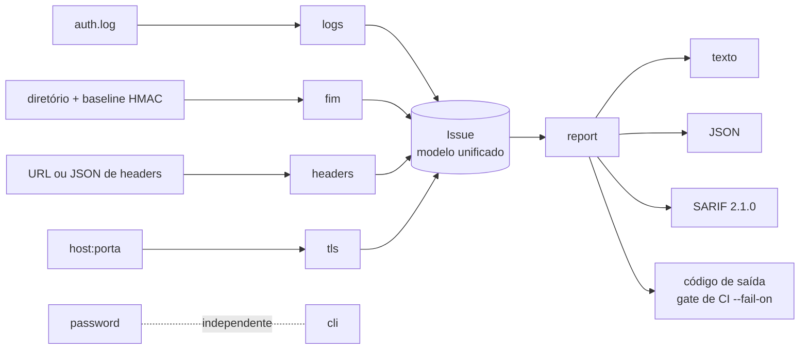

# SecFund — Toolkit Defensivo de Fundamentos de Cibersegurança

[](https://github.com/SEU_USUARIO/secfund/actions/workflows/ci.yml)


Cinco controles fundamentais de segurança defensiva (**detecção em logs, integridade de arquivos, senhas, headers HTTP e TLS**) em Python puro, **sem nenhuma dependência de runtime**. Cada achado é mapeado para **MITRE ATT&CK / OWASP / NIST / CIS** e pode ser exportado em **JSON** ou **SARIF 2.1.0** (o formato do GitHub Code Scanning), com código de saída pensado para **gates de CI**.

O foco não é "mais uma ferramenta", e sim mostrar como se escreve código de segurança: **tratar entrada como hostil**, **falhar de forma segura** e **documentar as decisões** ([modelo de ameaças](docs/THREAT_MODEL.md) e [ADRs](docs/DECISIONS.md)).

## Módulos

| Comando | O que faz | Referências |
|---|---|---|
| `logs` | Detecta **brute force**, **password spraying** e **ataque distribuído** (muitos IPs contra a mesma conta) em logs SSH; sinaliza possível comprometimento (login aceito após as falhas); suporta allowlist por CIDR, IPv6 e timestamps ISO 8601 | MITRE T1110.001/.003, T1078 · CIS 8 |
| `fim` | **Monitor de integridade de arquivos** (SHA-256) com **baseline assinada por HMAC**, que detecta adulteração da própria baseline e ataques de remoção de assinatura | MITRE T1565, T1505.003, T1070 · CIS 3 |
| `password` | Audita senhas (inclui variações *leetspeak*), **gera** senhas seguras, faz hash com **scrypt** (ou PBKDF2), **verifica** hashes e checa vazamentos via **k-anonymity** (HIBP) ou arquivo offline | NIST SP 800-63B · OWASP Password Storage |
| `headers` | Analisa **security headers HTTP** e **flags de cookies** (Secure/HttpOnly/SameSite) e dá nota A–F | OWASP A05:2021 |
| `tls` | Audita **certificado** (validade, cadeia, hostname, expiração), **protocolo** e **cipher suite** negociados | OWASP A02:2021 · CIS 3.10 |



## Instalação e uso

```bash
python -m pip install .            # ou apenas rode direto da pasta: python -m secfund
secfund --version
```

```bash
# Logs SSH: detecta ataques e ignora seu scanner interno
secfund logs samples/auth.log --year 2026 --allow-ip 10.0.0.0/8

# Integridade de arquivos com baseline assinada (guarde a chave FORA do servidor monitorado)
secfund fim keygen --key-file fim.key
secfund fim init  /var/www/site --baseline baseline.json --key-file fim.key --exclude "*.log"
secfund fim check /var/www/site --baseline baseline.json --key-file fim.key

# Senhas
secfund password --generate --length 24 --hash      # gera + audita + hash scrypt
secfund password --verify 'scrypt$131072$8$1$...'   # confere (e avisa se precisa de re-hash)
secfund password --pwned                            # só 5 chars do SHA-1 saem da máquina

# Web / TLS (somente alvos seus ou autorizados)
secfund headers --url https://seu-site.com
secfund tls seu-site.com:443

# Relatórios para ferramentas e CI
secfund logs auth.log --format sarif -o resultado.sarif
secfund headers --url https://seu-site.com --fail-on high     # só falha em ALTO/CRÍTICO
```

**Códigos de saída:** `0` limpo · `1` achados · `2` achado CRÍTICO · `3` erro de uso/E-S · `4` baseline adulterada.

### Exemplos reais de saída

`logs` (arquivo `samples/auth.log`):

```
28 eventos analisados | limiar=5 falhas/5min

[CRITICO] Brute force de 203.0.113.45: 7 falhas, 3 usuário(s) (T1110.001) [POSSÍVEL COMPROMETIMENTO: login aceito após as falhas]
    usuários-alvo: admin, root, ubuntu
[ALTO] Ataque distribuído de 6 IPs distintos: 6 falhas, 1 usuário(s) (T1110.001)
    usuários-alvo: deploy
    origens: 192.0.2.101, 192.0.2.102, 192.0.2.103, 192.0.2.104, 192.0.2.105, 192.0.2.106
[MEDIO] Password spraying de 198.51.100.7: 6 falhas, 6 usuário(s) (T1110.003)
```

`fim` — site desfigurado e web shell plantado; depois, o atacante tenta editar a baseline para esconder o rastro:

```
[MODIFICADO] site/index.html
[NOVO] site/shell.php

2 alteração(ões) detectada(s).            # exit 1

ALERTA DE INTEGRIDADE: assinatura inválida: baseline adulterada ou chave incorreta     # exit 4
```

## Decisões de segurança (o que diferencia de um tutorial)

| Risco | Como o código se defende | Onde está testado |
|---|---|---|
| **Log injection** — o atacante controla o nome de usuário e poderia forjar o IP atribuído ao evento (culpando um inocente e disparando bloqueios) | Regex ancoradas no fim da linha, IP validado com `ipaddress`, usuário sanitizado (sem ANSI/controle) e truncado, linhas gigantes descartadas | `tests/test_logs.py::TestParserHardening` |
| **Baseline adulterada** — quem muda os arquivos também reescreve a baseline | HMAC-SHA256 com chave externa; comparação em tempo constante | `tests/test_fim.py::TestSignedBaseline` |
| **Downgrade de assinatura** — remover a assinatura para a verificação "passar" | Se há chave e a baseline não tem assinatura, a verificação **falha** | `test_signature_stripping_downgrade_rejected` |
| **Hash armazenado como entrada hostil** — `n=2**30` forjado vira DoS | Parâmetros de custo limitados e validados antes de qualquer cálculo | `test_hostile_parameters_rejected_*` |
| **Timing attack** na verificação de senha/assinatura | `hmac.compare_digest` | — |
| **Unicode** — `é` composto vs. decomposto gerando hashes diferentes | Normalização NFKC (NIST 800-63B) | `test_unicode_normalization` |
| **Vazamento da senha ao checar HIBP** | k-anonymity: só 5 caracteres do SHA-1 trafegam; teste prova que o sufixo não sai | `TestPwnedOnline` |
| **SSRF/LFI** em `--url` | Apenas `http`/`https`; `file://`, `ftp://` etc. rejeitados | `test_rejects_non_http_scheme` |
| **Chave HMAC exposta** | `keygen` cria com `0600`, nunca sobrescreve (`O_EXCL`) e a CLI avisa se a permissão está frouxa | `TestKeys`, `TestKeyPermissionWarning` |
| **Symlinks** levando a fora do diretório monitorado | `os.walk(followlinks=False)` e symlinks ignorados | `test_symlinks_are_not_followed` |

## Qualidade e engenharia

- **126 testes** (unitários + integração com servidores TLS/HTTP locais em loopback), **97% de cobertura** (com branches) e piso de 90% no CI.
- `ruff` (inclui regras de segurança `S`), `mypy --strict` e `bandit` sem apontamentos.
- CI em Python 3.10–3.13, **CodeQL** semanal, **Dependabot**, permissões mínimas nos workflows.
- Zero dependências de runtime: nada de supply chain para auditar.

```bash
make all      # lint + tipos + SAST + testes com cobertura
```

## Usando como gate de CI

```yaml
- name: Auditar headers de segurança do staging
  run: secfund headers --url https://staging.exemplo.com --fail-on high --format sarif -o headers.sarif

- name: Enviar para a aba Security do GitHub
  uses: github/codeql-action/upload-sarif@v3
  with:
    sarif_file: headers.sarif
```

## Estrutura

```
secfund/        logs.py  fim.py  passwords.py  headers.py  tls.py  report.py  cli.py
tests/          unitários + integração (netfixtures.py sobe servidores locais)
samples/        log SSH com 4 cenários de ataque, headers fracos/com cookies
docs/           THREAT_MODEL.md  DECISIONS.md
.github/        CI, CodeQL, Dependabot
```

## Limitações conhecidas (e honestas)

- `logs`: foco em `sshd` (syslog e ISO 8601); o syslog tradicional não traz o ano (use `--year`) e a virada de ano não é tratada. Ataques distribuídos *lentos* (fora da janela) passam despercebidos.
- `fim`: execução sob demanda, sem *daemon* em tempo real (inotify/fanotify).
- `tls`: avalia o que foi **negociado** por um cliente moderno; não enumera todos os protocolos/ciphers aceitos (isso é varredura ativa, ex.: testssl.sh).
- `headers`: usa `HEAD`; alguns servidores só enviam `Set-Cookie` em `GET`.
- A lista embutida de senhas comuns é mínima de propósito; use `--pwned`/`--pwned-file` para cobertura real.

## Roadmap

- [ ] Parser para `journald` (JSON) e `auth.log` do Debian/RHEL com `/var/log/secure`
- [ ] `fim watch` com inotify e baseline com rotação de chaves
- [ ] Correlação multi-fonte (ex.: IP do brute force × IP do login aceito × arquivo novo)
- [ ] Publicação no PyPI com *trusted publishing* e SBOM

## Uso ético

Ferramenta **exclusivamente defensiva**. Analise somente sistemas, domínios e logs que você possui ou tem autorização por escrito para avaliar. Veja [SECURITY.md](SECURITY.md).

## Licença

MIT — veja [LICENSE](LICENSE).
